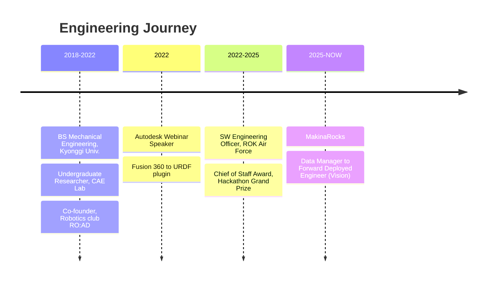

<div align="center">

# 👋 Hi, I'm Luke (Hyungjin Lee)

### Forward Deployed Engineer (Vision) @ MakinaRocks
#### *Robotics roots · Field deployment · Physical AI*

[](https://hyungjin-lee.pages.dev)
[](https://www.linkedin.com/in/%ED%98%95%EC%A7%84-%EC%9D%B4-ab1a29247/)
[](mailto:luke93052080@gmail.com)
[](https://informluke.tistory.com/)

</div>

---

## 🚀 About Me

> **"From CAD to the customer's site — I build it, ship it, and make it work in the field."**

I'm a **Forward Deployed Engineer** with a Mechanical Engineering background. I started by building robots — CAD in Fusion 360, URDF, ROS / Gazebo, Isaac Sim — and co-founded the robotics club **RO:AD**. As a **Software Engineering Officer in the ROK Air Force**, I built tools that non-developers used on closed military networks. Today at **MakinaRocks** I work directly with customers on **image generation** (LoRA fine-tuning, Image RAG, DPO alignment, VLM tagging).

```typescript
const luke = {
  name: "Hyungjin Lee (Luke)",
  role: "Forward Deployed Engineer (Vision) @ MakinaRocks",
  focus: ["Physical AI", "Robotics Data & Visualization", "Generative Vision"],
  background: {
    major: "B.S. Mechanical Engineering",
    experience: ["ROK Air Force SW Engineering Officer", "Robotics club RO:AD co-founder"],
  },
  languages: ["Korean (native)", "English"],
  techStack: ["Python", "ROS 2", "URDF", "Gazebo", "Foxglove", "PyTorch", "Fusion 360 API", "Blender API", "Docker"],
};
```

---

## 💼 Timeline



---

## 🛠️ Tech Stack

**🤖 Robotics & Simulation**


**🧠 AI / Vision**


**⚙️ CAD / 3D & Engineering**


**🧰 Infra & Web**


---

## 🎯 Projects

> Click a project to expand it. More detail on [hyungjin-lee.pages.dev](https://hyungjin-lee.pages.dev).

### 🤖 Robotics & Foxglove

<details>
<summary><b>🦾 Foxglove Robot Arm — pick & place debugging</b> · 2026</summary>
<br/>


- My own arm model from the RO:AD club, inspired by the arm on Boston Dynamics' Spot
- Fusion 360 → URDF → Blender scene → Gazebo / ROS 2 Jazzy → Foxglove
- Cameras, motor torque and joint tracking error in one Foxglove layout
- `docker compose up` · 19 end-to-end checks

`ROS 2` `Gazebo` `Foxglove` `URDF` `Docker` · [Repository](https://github.com/LUKE-hyungjin/foxglove_robot_arm)

</details>
<details>
<summary><b>🚗 Foxglove Robot Car — step-by-step tutorial</b> · 2026</summary>
<br/>


- Two-wheeled robot I modeled in Fusion 360, in an arena built with a Blender script
- 8-step tutorial: Fusion export → URDF → Gazebo → debug lidar and wheels in Foxglove
- Every step's output is in the repo, so readers can start at any step

`ROS 2` `Gazebo` `Foxglove` `Blender` · [Repository](https://github.com/LUKE-hyungjin/foxglove_basic_robot_car)

</details>
<details>
<summary><b>🔧 Fusion 360 URDF Generation — Autodesk Webinar</b> · 2022</summary>
<br/>

- Presented at the **Autodesk Korea Webinar** · [Watch](https://www.youtube.com/watch?v=n4WcBF8ReGQ)
- Exports joints, mass / inertia / center of mass, colors and materials from Fusion 360
- Works with Unity, NVIDIA Omniverse (Isaac Sim) and ROS 2

`Fusion 360 API` `Python` `URDF` · [fusion360_urdf_script](https://github.com/LUKE-hyungjin/fusion360_urdf_script) · [RO-AD/fusion2urdf_ros2cpp](https://github.com/RO-AD/fusion2urdf_ros2cpp) · [Details](https://hyungjin-lee.pages.dev/projects/fusion360-urdf)

</details>
<details>
<summary><b>🛡️ National Defense Robotics Competition — RO:AD</b> · 2021</summary>
<br/>

- Designed a tracked vehicle and robotic arm in Fusion 360
- URDF → Gazebo simulation → ROS integration
- Co-founded and systematized the club RO:AD · [Video](https://www.youtube.com/watch?v=NY-tPyoulmk&t=60s)

`ROS` `Gazebo` `URDF` `Fusion 360` · [Details](https://hyungjin-lee.pages.dev/projects/national-defense-robotics)

</details>
<details>
<summary><b>🚘 Automated Vehicle Accident Reporting — RO:AD project lead</b> · 2022</summary>
<br/>

- Led the club's semi-annual project: accident detection with FLEX pressure sensors in bumpers
- Taught new members ROS, CAD modeling and software basics

`ROS` `Sensors` `Python` · [Details](https://hyungjin-lee.pages.dev/projects/automated-accident-reporting)

</details>
<details>
<summary><b>🦿 F-ARM — robotic arm fault diagnosis (Capstone Grand Prize)</b> · 2021</summary>
<br/>

- Deep learning fault diagnosis for a robotic arm from vibration sensor data (CNN / LSTM)
- **Grand Prize**, Capstone Design Competition · graduation thesis

`TensorFlow` `Keras` `Sensor Data` · [Details](https://hyungjin-lee.pages.dev/projects/robotic-arm-fault-diagnosis)

</details>

### 🛡️ ROK Air Force (2022–2025)

<details>
<summary><b>📦 Wartime Resource Analysis Program</b> · 2024</summary>
<br/>

- Automated wartime supply-requirement calculation (personnel, aircraft, fuel, supplies, spare parts)
- Months of manual calculation → minutes; used for actual resource allocation
- Built with Python + KNIME for non-developer staff on a closed military network

`Python` `KNIME` `Data Analysis` · [Details](https://hyungjin-lee.pages.dev/projects/wartime-resource-analysis)

</details>
<details>
<summary><b>🏆 Wargame Simulation Automation — Hackathon Grand Prize</b> · 2025</summary>
<br/>

- Python macro for automated target-data input — 90% less manual time
- **Air Force Chief of Staff Award (Grand Prize)**, 6th Air Force Hackathon

`Python` · [Repository](https://github.com/LUKE-hyungjin/macro) · [Details](https://hyungjin-lee.pages.dev/projects/wargame-simulation)

</details>
<details>
<summary><b>📡 Radar Detection Range Analysis</b> · 2025</summary>
<br/>

- Detection-range analysis program for air-defense planning

`Python` · [Details](https://hyungjin-lee.pages.dev/projects/radar-systems)

</details>
<details>
<summary><b>🧪 Genesis AI for Military Reinforcement Learning</b> · 2025</summary>
<br/>

- 10–80x faster RL training than Unity ML-Agents; up to 65x in collision-heavy scenes
- 4,096 parallel environments on GPU
- Presented at the 2025 Korea Military Science and Technology conference

`Genesis` `Reinforcement Learning` `Python` · [Genesis GUI](https://github.com/LUKE-hyungjin/genesis_ai_gui) · [Details](https://hyungjin-lee.pages.dev/projects/genesis-ai-military-research)

</details>
<details>
<summary><b>🎓 Air Force AI Education Program</b> · 2024</summary>
<br/>

- Designed and taught an AI course for Air Force personnel: RL fundamentals, PPO, hyperparameter tuning
- Practical AI workflows with Cursor, RAG and Obsidian; sim-to-real gaps for military AI

`Reinforcement Learning` `PPO` `Education` · [Details](https://hyungjin-lee.pages.dev/projects/ai-education-program)

</details>

### 🔬 Research & Simulation

<details>
<summary><b>✈️ Deep-FEM UAV Wing — GNN surrogate for FEM</b> · 2026</summary>
<br/>

- Blender → Gmsh → CalculiX → PyTorch Geometric (GraphSAGE)
- 200 parametric wing cases; ~600x faster than FEM
- [Live demo on Hugging Face](https://huggingface.co/spaces/hyungjin12/deep-fem-uav-wing)

`PyTorch Geometric` `FEM` `Gradio` · [Repository](https://github.com/LUKE-hyungjin/Deep-FEM-UAV-Wing)

</details>
<details>
<summary><b>🚦 Unity ML-Agents — autonomous driving & drone delivery</b> · 2021</summary>
<br/>

- Crossroad autonomous-driving environment (Gangnam Station, BlenderGIS) and RLKR drone-delivery challenge
- KIISE conference paper, 2nd author — advanced to the finals

`Unity` `ML-Agents` `PPO` · [Details](https://hyungjin-lee.pages.dev/projects/unity-ml-agent-projects)

</details>

### ⚙️ Engineering

<details>
<summary><b>🔩 Semiconductor Wafer-Transfer Robot (SD Solution intern)</b> · 2021</summary>
<br/>

- Improved Z-axis instability of a wafer-transfer robot with regression on sensor data

`Python` `Machine Learning` · [Details](https://hyungjin-lee.pages.dev/projects/semiconductor-zig-analysis)

</details>
<details>
<summary><b>🏎️ University Self-Built Car Competition (KURC)</b> · 2019</summary>
<br/>

- Led engine overhaul (125cc) and vehicle wiring; torsional stiffness analysis in ANSYS
- **Acceleration Prize**, Yeungnam University Self-Built Car Competition

`Fusion 360` `ANSYS` · [Details](https://hyungjin-lee.pages.dev/projects/self-built-car-competition)

</details>

---

## 🏆 Achievements

* **Air Force Chief of Staff Award (Grand Prize)** — 6th Air Force Hackathon (2024)
* **Autodesk Korea Webinar Speaker** — Fusion 360 API for robot simulation (2022)
* **Grand Prize, Capstone Design Competition** — ML fault diagnosis for a robotic arm (2021)
* **KIISE conference finalist** — Unity ML-Agents autonomous driving (2nd author, 2021)
* **TensorFlow Developer Certificate** · **NVIDIA DLI** · **Engineer Information Processing**

---

## 📫 Let's Connect!

Always happy to talk about **robotics data, Physical AI, simulation, and deploying AI in the field**.

<div align="center">

### "Engineering the Physical World with Digital Intelligence"

</div>
