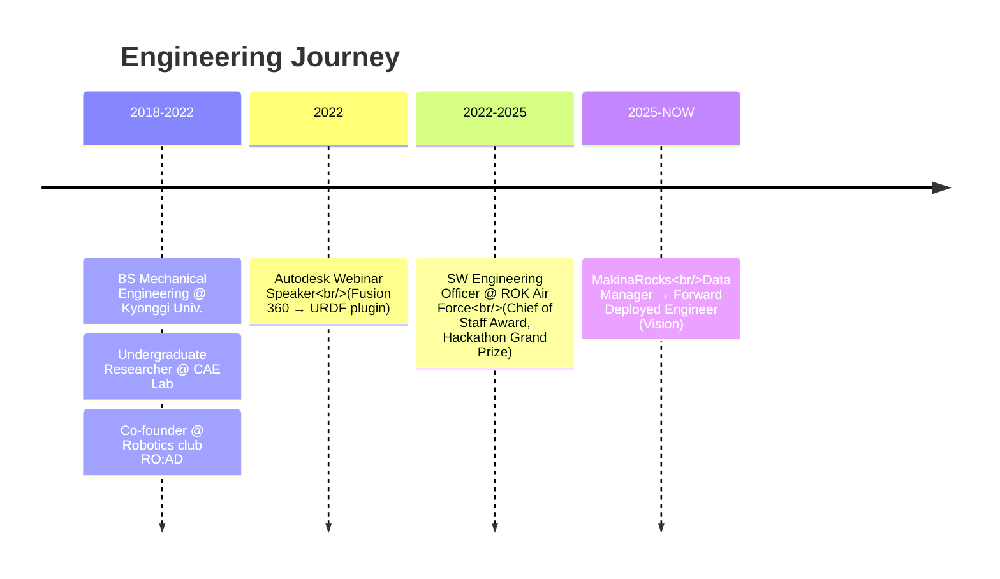

<div align="center">

# 👋 Hi, I'm Luke (Hyungjin Lee)

### Forward Deployed Engineer (Vision) @ MakinaRocks
#### *Robotics roots · Field deployment · Physical AI*

[](https://hyungjin-lee.pages.dev)
[](https://www.linkedin.com/in/%ED%98%95%EC%A7%84-%EC%9D%B4-ab1a29247/)
[](mailto:luke93052080@gmail.com)
[](https://informluke.tistory.com/)

</div>

---

## 🚀 About Me

> **"From CAD to the customer's site — I build it, ship it, and make it work in the field."**

I'm a **Forward Deployed Engineer** with a Mechanical Engineering background. I started by building robots — CAD in Fusion 360, URDF, ROS / Gazebo, Isaac Sim — and co-founded the robotics club **RO:AD**. As a **Software Engineering Officer in the ROK Air Force**, I built tools that non-developers used on closed military networks. Today at **MakinaRocks** I work directly with customers on **image generation** (LoRA fine-tuning, Image RAG, DPO alignment, VLM tagging).

```typescript
const luke = {
  name: "Hyungjin Lee (Luke)",
  role: "Forward Deployed Engineer (Vision) @ MakinaRocks",
  focus: ["Physical AI", "Robotics Data & Visualization", "Generative Vision"],
  background: {
    major: "B.S. Mechanical Engineering",
    experience: ["ROK Air Force SW Engineering Officer", "Robotics club RO:AD co-founder"],
  },
  languages: ["Korean (native)", "English"],
  techStack: ["Python", "ROS 2", "URDF", "Gazebo", "Foxglove", "PyTorch", "Fusion 360 API", "Blender API", "Docker"],
};
```

---

## 💼 Timeline



---

## 🛠️ Tech Stack

**🤖 Robotics & Simulation**


**🧠 AI / Vision**


**⚙️ CAD / 3D & Engineering**


**🧰 Infra & Web**


---

## 🎯 Featured Projects

<table>
<tr>
<td width="50%" valign="top">

### 🦾 [Foxglove Robot Arm](https://github.com/LUKE-hyungjin/foxglove_robot_arm)
**Pick & place, debugged in Foxglove**


- 🤖 My own arm model (RO:AD era, inspired by Boston Dynamics Spot's arm)
- 🔁 Fusion 360 → URDF → Blender scene → Gazebo / ROS 2 Jazzy → Foxglove
- 📈 Cameras, motor torque, joint tracking error in one layout
- ✅ `docker compose up` · 19 end-to-end checks

`ROS 2` `Gazebo` `Foxglove` `URDF` `Docker`

</td>
<td width="50%" valign="top">

### 🚗 [Foxglove Robot Car Tutorial](https://github.com/LUKE-hyungjin/foxglove_basic_robot_car)
**8-step tutorial for new Foxglove users**


- 🛠️ Two-wheeled robot I modeled in Fusion 360
- 🗺️ Arena built with a Blender script
- 📡 Debug lidar, wheel speed error, odometry vs. ground truth
- 📚 Every step's output in the repo — start anywhere

`ROS 2` `Gazebo` `Foxglove` `Blender`

</td>
</tr>

<tr>
<td width="50%" valign="top">

### 🔧 [Fusion 360 → URDF](https://github.com/LUKE-hyungjin/fusion360_urdf_script)
**CAD-to-simulation plugin**

- 🎤 Presented at **Autodesk Korea Webinar** (2022) · [Watch](https://www.youtube.com/watch?v=n4WcBF8ReGQ)
- ⚖️ Joints, mass / inertia, colors & materials exported automatically
- 🎮 Works with Unity, NVIDIA Omniverse (Isaac Sim), ROS 2
- 🔗 Original: [RO-AD/fusion2urdf_ros2cpp](https://github.com/RO-AD/fusion2urdf_ros2cpp)

`Fusion 360 API` `Python` `URDF`

</td>
<td width="50%" valign="top">

### ✈️ [Deep-FEM UAV Wing](https://github.com/LUKE-hyungjin/Deep-FEM-UAV-Wing)
**GNN surrogate model for FEM**

- 🔁 Blender → Gmsh → CalculiX → PyG (GraphSAGE)
- 📊 200 parametric wing cases
- ⚡ ~600x faster than FEM
- 🖥️ [Live demo on Hugging Face](https://huggingface.co/spaces/hyungjin12/deep-fem-uav-wing)

`PyTorch Geometric` `FEM` `Gradio`

</td>
</tr>

<tr>
<td width="50%" valign="top">

### 🧪 Genesis AI for Military RL
**Physics-based RL research**

- ⚡ 10–80x faster RL training vs. Unity ML-Agents
- 🧮 4,096 parallel environments on GPU
- 📄 Presented at 2025 KIMST conference
- 🖱️ [Interactive Genesis GUI](https://github.com/LUKE-hyungjin/genesis_ai_gui)

`Genesis` `Reinforcement Learning` `Python`

</td>
<td width="50%" valign="top">

### 🛡️ Defense Robotics Competition
**Tracked robot & robotic arm (RO:AD)**

- 🏁 National Defense Robotics Competition (2021)
- 🔩 Full mechanical design in Fusion 360
- 🤖 URDF → Gazebo simulation → ROS integration
- 👥 Co-founded RO:AD and taught members ROS

`ROS` `Gazebo` `URDF` `Fusion 360`

</td>
</tr>
</table>

---

## 🏆 Achievements

* **Air Force Chief of Staff Award (Grand Prize)** — 6th Air Force Hackathon (2024)
* **Autodesk Korea Webinar Speaker** — Fusion 360 API for robot simulation (2022)
* **Grand Prize, Capstone Design Competition** — ML fault diagnosis for a robotic arm (2021)
* **KIISE conference finalist** — Unity ML-Agents autonomous driving (2nd author, 2021)
* **TensorFlow Developer Certificate** · **NVIDIA DLI** · **Engineer Information Processing**

---

## 📫 Let's Connect!

Always happy to talk about **robotics data, Physical AI, simulation, and deploying AI in the field**.

<div align="center">

### "Engineering the Physical World with Digital Intelligence"

</div>
